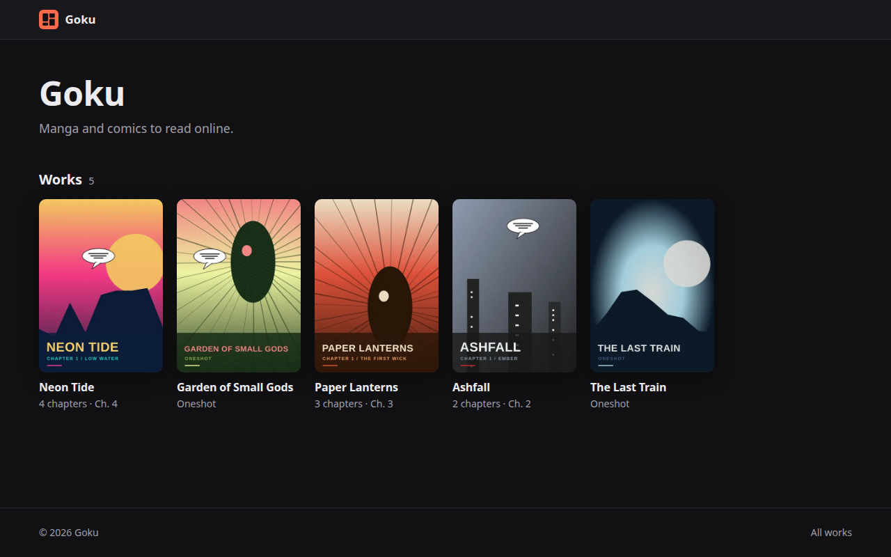
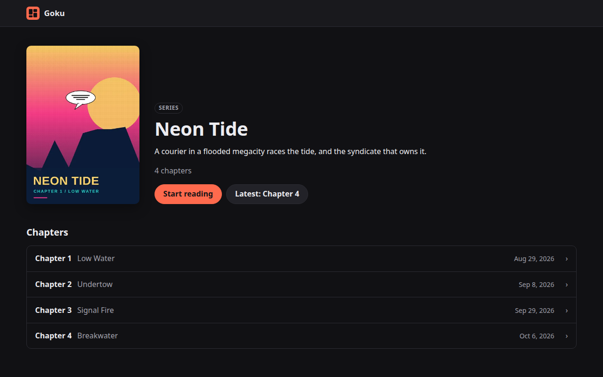
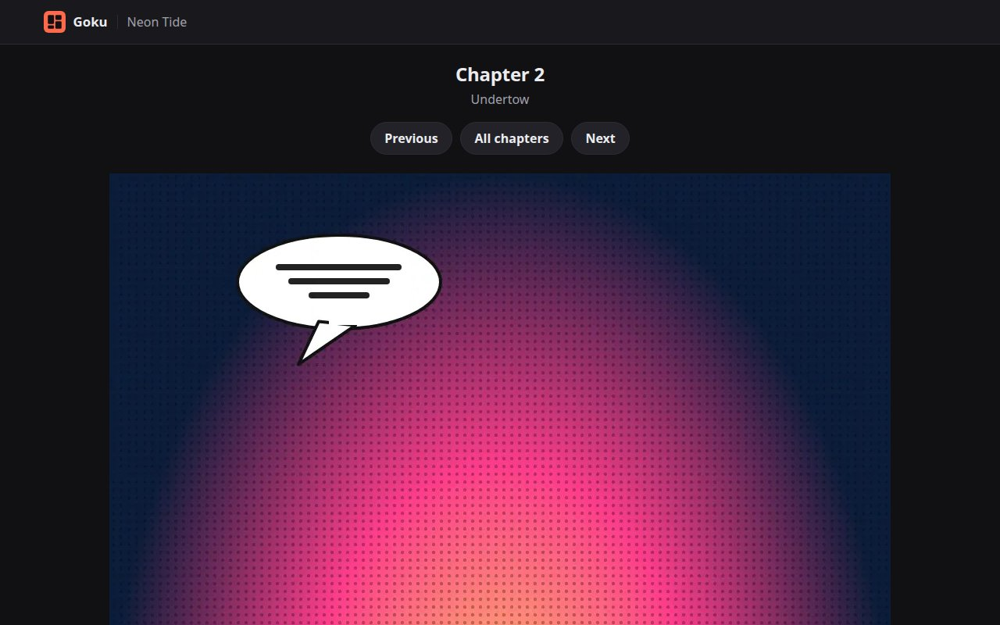
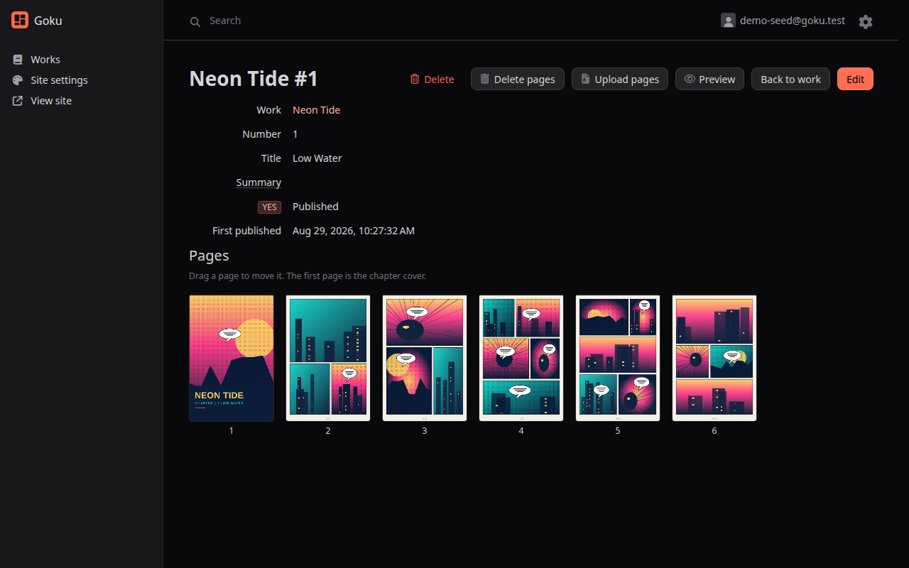
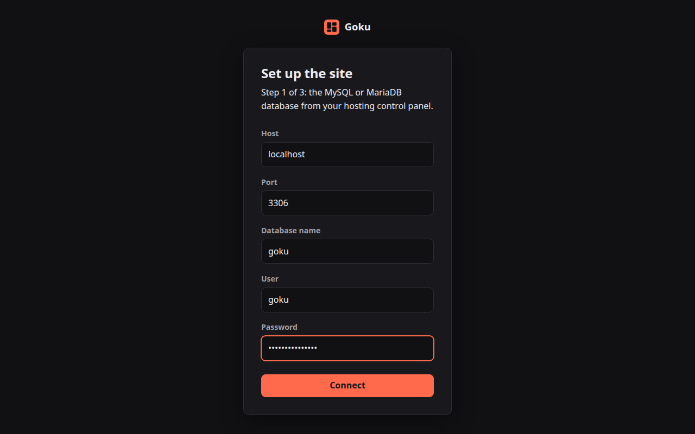
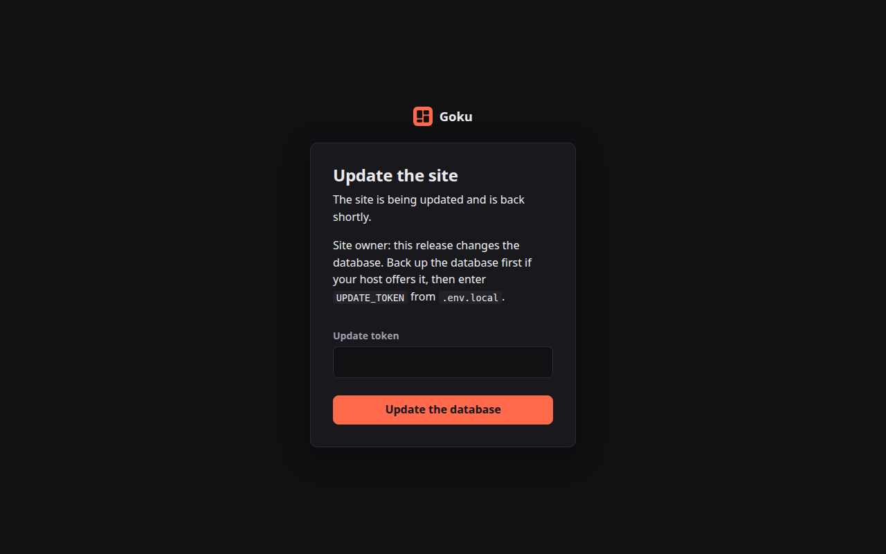

# Goku (shared-hosting edition)

Self-hosted manga and comics site for one artist: public reading, invite-only posting. This
edition runs on ordinary shared hosting: Apache with `.htaccess`, PHP, MySQL or MariaDB and a
cron job. No shell, Redis or libvips needed.

## Screenshots

| Works | Work page |
|---|---|
|  |  |
| **Reader** | **Admin: chapter pages** |
|  |  |
| **Installer** | **Updater** |
|  |  |

<p align="center"></p>

## Host requirements

- PHP 8.4 with `pdo_mysql`, `zip`, `fileinfo`, and Imagick or GD with WebP support
- MySQL 8 or MariaDB 10.6 or newer, one empty database (tested on MySQL 8.0 and MariaDB 11.4)
- Apache with `mod_rewrite` (`mod_headers` and `mod_deflate` are used when present)
- A cron job every minute (every 5 minutes works, pages just appear later)
- `memory_limit` of 256M or more. With GD only, very tall strips (webtoon style) need more
  (a 1600x20000 strip needs about 350M); a page that does not fit is marked failed in admin.

## Install

1. Unzip `goku-<version>.zip` and upload the `goku` folder.
2. Point the domain's document root at `goku/public`. If the host does not let you choose the
   document root, put the folder's contents in the document root itself, or in a subfolder of it
   for a site at `example.com/manga/`: the root `.htaccess` then serves everything from `public/`
   and keeps the rest unreachable.
3. Open the site. The installer checks the host, asks for the database credentials, writes them
   to `.env.local`, creates the tables and the first user. Do this right after uploading: until
   the first user exists, whoever opens the site first runs the installer.
4. Add the cron job (adjust the PHP binary and path to what your host shows):

   ```
   * * * * * php /home/USER/goku/bin/console messenger:consume async --time-limit=55 --memory-limit=128M --quiet
   ```

   Chapter archives are processed by this job. Keep `--time-limit` below the cron interval. On
   cPanel, plain `php` in cron is often a different PHP version than the site's; use the full path
   of the 8.4 binary (for example `/opt/cpanel/ea-php84/root/usr/bin/php`).

Uploads are sent in slices below the host's upload limit, so archives larger than
`upload_max_filesize` work. If the cron job is missing or failing, admin shows a warning once jobs
wait longer than 10 minutes.

## Upgrade

1. Back up the database and the storage folder.
2. Unzip the new release over the installed `goku` folder. `.env.local` and `var/` are kept;
   the new release compiles its own cache in a new `var/cache/prod-<release>` folder (older ones
   can be deleted).
3. If the release changes the database, every page shows "being updated" until you enter
   `UPDATE_TOKEN` from `.env.local` there and press "Update the database". Then log in again.

## Configuration

`.env.local` (written by the installer) can also set:

- `IMAGE_PROCESSOR`: `auto` (default), `vips`, `imagick` or `gd`. `auto` takes the first the host
  offers in that order.
- `STORAGE_PATH`: where originals and generated images live. Default `var/storage`; a folder
  outside the document root is better when the host allows it.
- `SITE_NAME`, `SITE_DESCRIPTION`: defaults until the site settings are saved in admin.

## Development

Docker Compose mimics a shared host: PHP with Apache, MariaDB, GD and Imagick, no Redis and no
libvips, 8 MB upload limit.

```
make up        # http://localhost:8010, then run the installer (host: database, database/user/password: app)
make install   # composer install
make test      # PHPUnit against MariaDB
make stan      # PHPStan level 8
make worker    # one cron-length worker run
make release   # dist/goku-<version>.zip
```
